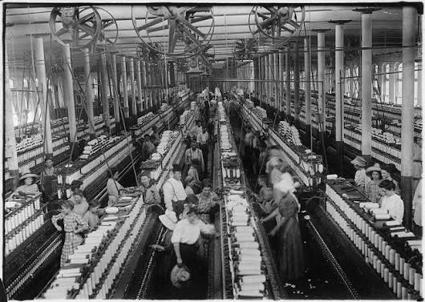
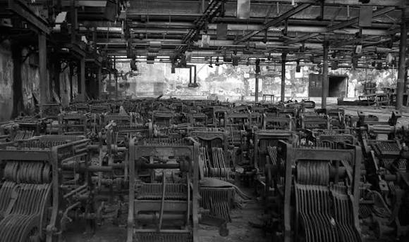

# Your Place and Its World

A spatial history of your place and the places it was tied to.

## The Map

<iframe src="map/" width="100%" height="520"
  style="border:1px solid #ccc; border-radius:8px;"></iframe>

## The Essay

Paste your essay here as normal paragraphs.
Leave a blank line between each paragraph.

*A cotton mill in Bombay, around 1890.*

*A second cotton mill in Bombay, around 1890.*
